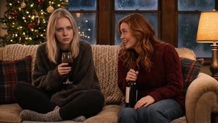
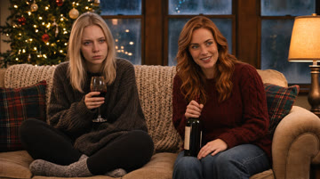
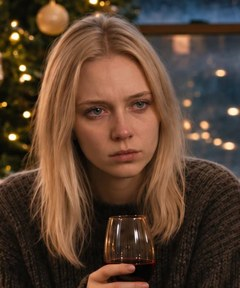
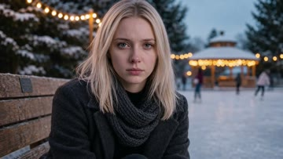
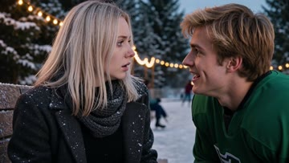
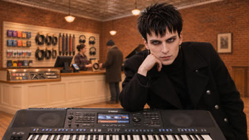
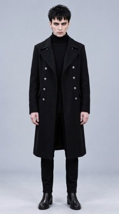
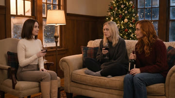

# HOLIDAY RESERVATIONS: Omni Flash 1.2 prompt guide (Ingredients mode)

For the head-to-head with the Supergen cut: the same scenes, keyframes and characters, rewritten for Omni Flash's **Ingredients** mode (tested with 7 images). Omni Flash can't take uploaded audio, so it voices the lines and makes the sound itself. Each prompt below therefore describes the voices and the foley in words.

## How to use these prompts
- **Images:** attach them in the order listed. The prompt names each one as *Image 1, Image 2...*, so the order matters.
- **Image roles:** the first image sets the opening composition, the next ones are the set and the props, and the characters come last (one clear, front-facing face per character, plus a wardrobe picture if there's room).
- **Length:** up to 15s per scene. The shot timings are lengths, not lip-sync anchors.
- **Dialogue:** a line is spoken by the character named in front of it. Each character gets a short voice description, so Omni Flash voices them consistently from scene to scene.
- **Music:** none. The score and the song bed go in afterwards. The exception is the bossa nova in Scene 5, which is a sound inside the scene.
- **Watch words:** keep "flash", "bright", "static" and "spark" out of the prompts. In Supergen they caused full-frame white flashes, so they're avoided here too until Omni Flash has been tested with them.
- **Thumbnails:** the ones marked *stand-in* are crops of our frames, shown only so you can identify the picture. Attach your original file.

## Character voices (use the same wording every time)
- **Kallista:** a soft, low, dry American voice, a little husky; deadpan and unhurried.
- **Becca:** a bright, warm American voice, quick and teasing.
- **Chase:** a smooth, cocky young American drawl.
- **Barista:** silent (a wink only).
- **Adrian:** a low, velvety British voice; self-serious and slow.
- **Milly:** a flat, even, pleasant American voice that answers a beat late.

---

## Scene 1: Couch, "Something weird happened today" (15s)

| Image | File | Thumbnail | Role |
|---|---|---|---|
| 1 | `pic_1619a74c7520` (the corrected couch two-shot; same start as the Supergen take) |  | Opening composition |
| 2 | `keyframes/holiday-reservations/couch2_front_v2.png` |  | Both faces front-on (identity) |
| 3 | Your S1 B&B sitting-room set picture | — | The room |
| 4 | Your Kallista identity shot 1 (front close-up) |  *stand-in* | Kallista's face |
| 5 | Your indoor Becca portrait (no hat or scarf) |  *stand-in* | Becca's face |

```
A 15-second cinematic live-action romantic comedy scene in 16:9. Late at night in a cozy bed-and-breakfast sitting room (Image 3): a soft sofa, a decorated Christmas tree, frosted windows, warm lamp and firelight. Open on the two-shot from Image 1. Kallista (Images 2 and 4) sits cross-legged on the left in an oversized charcoal knit sweater, holding a glass of red wine: pale skin, a longer face with defined cheekbones, large pale blue-grey eyes, sad slightly down-turned brows, straight sleek pale platinum-blonde hair with a center part. Reserved and deadpan; her feelings show only in her eyes. Becca (Images 2 and 5) sits on the right in a burgundy cable-knit sweater, holding a bottle of red wine by its neck: long wavy auburn hair, freckles, warm green-brown eyes. Warm, playful and teasing, with small, loose gestures. Keep both faces exactly as in the references.

Shot 1 (about 4s), the two-shot from Image 1: Kallista gives a small, embarrassed half-laugh, turns her wine glass and glances down. Kallista: "So... something weird happened today."
Cut to Shot 2 (about 2s), a medium close-up of Becca: she gasps, her eyes lighting up. Becca: "You met someone!"
Cut to Shot 3 (about 4s), a medium close-up of Kallista: she groans and tips her head back slightly, then looks at Becca, dry and defensive. Kallista: "No, Becca. I did not 'meet someone.'"
Cut to Shot 4 (about 4s), a medium close-up of Becca: a slow, teasing nod, not believing a word. Becca: "Mm-hm. The ice rink." She raises one eyebrow. Becca: "Hockey player."
Cut to Shot 5 (about 1s), back to the two-shot: Kallista gives her a flat, unimpressed look over the rim of her glass.

Voices: Kallista has a soft, low, dry American voice, a little husky and deadpan. Becca has a bright, warm American voice, quick and teasing. Only the woman speaking moves her lips.
Sound: a gentle crackling fireplace, soft room hum, the faint clink of a wine glass. No music, no other voices.
Look: 35mm Kodak Vision3 500T film with a 1/4 Pro-Mist filter, soft halation on the tree lights, shallow depth of field, organic film grain. No subtitles, no text, no watermark, no extra people.
```

---

## Scene 2: Rink flash, "Hey..." (5s)

| Image | File | Thumbnail | Role |
|---|---|---|---|
| 1 | Rink start frame (revision 2b, the close front-facing frame) |  | Opening composition |
| 2 | Your S4 rink set picture | — | The rink |
| 3 | Your Kallista identity shot 1 |  *stand-in* | Kallista's face |
| 4 | Your Kallista coat portrait (Outfit A + outdoor layer) | — | Coat and scarf |
| 5 | Your Chase portrait |  *stand-in* | Chase |

```
A 5-second cinematic live-action romantic comedy flashback in 16:9 at an outdoor small-town ice rink at dusk (Image 2): string lights, a lit gazebo, light snow. Open on Image 1: a medium close-up of Kallista (Images 3 and 4) on a wooden bench at the rink's edge, in a charcoal wool coat and dark grey chunky knit scarf: pale skin, a longer face, large pale blue-grey eyes, straight sleek pale platinum-blonde hair. Reserved and dry; she never speaks. Chase (Image 5) is a cocky young hockey player with tousled sandy-blond hair, deep dimples and a plain dark green jersey, with no helmet.

Shot 1 (about 1.2s), Image 1: Kallista looks down, lacing her skates. Behind her on the right, Chase skates fast straight toward her.
Shot 2 (about 0.8s), same framing: he skids to a hard hockey stop beside her, and a spray of shaved ice showers her coat, scarf and hair. She jerks back, both hands up, palms out, eyes wide.
Cut to Shot 3 (about 1.5s), a close two-shot: Chase leans in beside her with a dimpled grin. Chase: "Hey..."
Cut to Shot 4 (about 1.5s), a close-up of Kallista: she slowly lowers her hands, ice in her hair and eyebrows, and gives him a flat, completely unimpressed stare, mouth closed.

Voice: Chase has a smooth, cocky young American drawl.
Sound: skate blades carving the ice, the hard scrape of the stop, the hiss of spraying ice, distant skaters, a light breeze. No music.
Look: 35mm Kodak Vision3 500T film with a 1/4 Pro-Mist filter, warm string-light glow against a cool blue dusk, shallow depth of field, film grain. No subtitles, no text, no watermark.
```

---

## Scene 3: Couch, "The coffee shop!" / "Nobody does that." (12s)

In the Supergen cut, Becca's music-store line plays over Kallista's reaction. Omni Flash can lip-sync it on camera, so it's included here.

| Image | File | Thumbnail | Role |
|---|---|---|---|
| 1 | `keyframes/holiday-reservations/couch2_front_v2.png` |  | Opening composition and faces |
| 2 | Your S1 B&B sitting-room set picture | — | The room |
| 3 | Your Kallista identity shot 1 |  *stand-in* | Kallista's face |
| 4 | Your indoor Becca portrait |  *stand-in* | Becca's face |

```
A 12-second cinematic live-action romantic comedy scene in 16:9, continuing the late-night conversation on the sofa in the cozy bed-and-breakfast sitting room (Image 2). Open on Image 1, a frontal two-shot. Kallista (Images 1 and 3) is on the left in an oversized charcoal knit sweater with a glass of red wine: pale skin, a longer face, large pale blue-grey eyes, sad down-turned brows, straight sleek pale platinum-blonde hair with a center part; deadpan and contained. Becca (Images 1 and 4) is on the right in a burgundy cable-knit sweater, holding a bottle of red wine by its neck: long wavy auburn hair, freckles; warm and teasing. Keep both faces exactly as in the references, both mostly facing the camera.

Shot 1 (about 6s), the two-shot from Image 1, with a very slow push-in: Kallista gives Becca a slow, dead-eyed shake of her head. Becca points the bottle at her, leaning in, conspiratorial and delighted. Becca: "The coffee shop! He spelled your name wrong on purpose... so you'd have to talk to him."
Cut to Shot 2 (about 2s), a medium close-up of Kallista: she takes a small sip of wine, lowers the glass, flat. Kallista: "Nobody does that."
Cut to Shot 3 (about 3s), a medium close-up of Becca: her face lights up, and she sits up straight. Becca: "Ooh, the music store! Some broody musician."
Cut to Shot 4 (about 1s), a close-up of Kallista: she closes her eyes and sinks slightly into the sofa, mouth closed.

Voices: Kallista has a soft, low, dry American voice, a little husky and deadpan. Becca has a bright, warm American voice, quick and teasing.
Sound: a gentle crackling fireplace, soft room hum, a quiet sip and the clink of a glass. No music.
Look: 35mm Kodak Vision3 500T film with a 1/4 Pro-Mist filter, warm practical light, soft halation on the tree lights, shallow depth of field, film grain. No subtitles, no text, no watermark, no extra people.
```

---

## Scene 4: Café flash, "CALLISTUH" (4s)

| Image | File | Thumbnail | Role |
|---|---|---|---|
| 1 | `pic_550298c4b8ba` (barista start frame) |  | Shot 1 composition and the cup |
| 2 | `pic_1e5dc4fea01a` (Kallista café stare) |  | Shot 2 composition |
| 3 | Your S5 café set picture | — | The café |
| 4 | Your Kallista identity shot 1 |  *stand-in* | Kallista's face |

```
A 4-second cinematic live-action romantic comedy flashback in 16:9 in a cozy small-town café in the morning (Image 3): a wooden counter, a chalkboard menu, an espresso machine, Christmas garland, warm window light.
Shot 1 (about 2s), matching Image 1, from the customer's point of view across the counter: a barista with a dark brown man bun, a groomed full beard, an olive flannel shirt and a brown canvas apron holds up a white paper cup beside his face. Written on it in black marker is "CALLISTUH" with a small heart, sharp and legible, and the writing never changes. He gives one slow, flirty wink and a smug little nod, mouth closed.
Cut to Shot 2 (about 2s), matching Image 2: Kallista (Images 2 and 4) stands at the counter facing the barista, in a charcoal wool coat over a black mock-neck and a dark grey chunky knit scarf: pale skin, a longer face, large pale blue-grey eyes, straight sleek pale platinum-blonde hair. A completely flat, dead stare. She blinks once, slowly. Her mouth stays closed.

Sound: café ambience, an espresso machine hissing, cups clinking softly, distant murmur. No dialogue, no music.
Look: 35mm Kodak Vision3 500T film with a 1/4 Pro-Mist filter, warm morning window light, shallow depth of field, film grain. No subtitles, no other text, no watermark.
```

---

## Scene 5: Music store, Adrian and the bossa nova (12s)

| Image | File | Thumbnail | Role |
|---|---|---|---|
| 1 | `keyframes/holiday-reservations/music_E_kallista_wide.png` |  | Opening wide shot and the store |
| 2 | `keyframes/holiday-reservations/music_A_adrian_pov.png` |  | Adrian's reverse angle and face |
| 3 | `keyframes/holiday-reservations/music_C_kallista_stare.png` |  | Kallista's close-up |
| 4 | Adrian's full-body greatcoat shot |  | His coat, seen from behind as he enters |
| 5 | Your Kallista identity shot 1 |  *stand-in* | Kallista's face |
| 6 | The PSR-SX920 product photo (check it isn't mirrored) | — | The keyboard panel |
| 7 | *(optional)* Adrian's music-video headshot |  | Only if his face drifts. Its ruffled shirt can pull in the wrong wardrobe |

```
A 12-second cinematic live-action romantic comedy flashback in 16:9 in a small-town music store in the afternoon: brick walls, a wall of guitars, pianos, front windows with snow outside and garland. Five shots joined by clean hard cuts.
Kallista (Images 1, 3 and 5): pale skin, a longer face with defined cheekbones, large pale blue-grey eyes, sad down-turned brows, straight sleek pale platinum-blonde hair with a center part, a charcoal wool coat and a dark grey chunky knit scarf. Deadpan; she never speaks. Adrian (Images 2 and 4): pale skin, spiky black hair with a choppy fringe, smoky eyeliner, small gold cross earrings, a long black double-breasted greatcoat with silver buttons over a black turtleneck. A self-serious, brooding frontman, until things go wrong. They only ever look at each other; nobody looks into the camera.
The room: the keyboard (Image 6) stands in the middle of the store. Kallista stands behind it at its controls, with the front windows behind her. The camera starts on the other side, looking at the keyboard's back panel.

Shot 1 (about 2s), the wide shot from Image 1, locked: Kallista looks down and presses a button. Adrian walks in from the bottom-right corner on the camera's side of the keyboard with his back to us; we see only his spiky black hair and the back of his greatcoat. He stops across the keyboard from her and leans one elbow on it, facing her.
Cut to Shot 2 (about 2s), the reverse angle from Image 2, from Kallista's side: Adrian leans across the keyboard, elbow on the panel, chin on his hand, eyes on her just beside the camera. Adrian: "You play?"
Cut to Shot 3 (about 1s), Kallista's close-up from Image 3: her brow furrows slightly, mouth closed, while his voice continues off screen. Adrian: "Perhaps we could make..."
Cut to Shot 4 (about 4s), back on Adrian as in Image 2: he leans closer and murmurs. Adrian: "...something... beautifully dark—" Under the line, four quiet keyboard metronome ticks count in. On the word "dark" a cheesy 1990s home-keyboard bossa nova demo blasts on at full volume. He freezes, looks down in horror, then straightens and frantically twists knobs and prods panel buttons; the beat only speeds up. A cheesy keyboard voice sample shouts "Woo!"
Cut to Shot 5 (about 3s), closer on Kallista as in Image 3: she covers her mouth with her hand and lets out one short, stifled laugh, then stays deadpan behind her hand while the bossa nova keeps playing.

Voice: Adrian has a low, velvety British voice, self-serious and slow. Kallista's only sound is the short stifled laugh.
Sound: quiet store ambience; four soft metronome ticks; the tinny bossa nova demo (drum machine, cheap electric piano, plucky synth bass), getting faster; the "Woo!" sample; knob and button clicks. Background shoppers stay small and natural: people walk past outside the windows, and a clerk rings up a customer at the counter.
Look: 35mm Kodak Vision3 500T film with a 1/4 Pro-Mist filter, warm afternoon window light, shallow depth of field, film grain. No subtitles, no text, no watermark, no slow motion.
```
For a strictly like-for-like comparison, you can mute Omni Flash's audio and lay our post-production track on top (the bossa nova #1 mix).

---

## Scene 6: Couch, "You watch way too many of these movies." → "...The laundromat." (12s)
The risk here is **invented backgrounds on new angles** (the Omni Flash angled close-ups of Kallista and Becca drifted before). So every shot is told to match one of the attached camera setups exactly, and they're all frontal or three-quarter angles that already exist.

| Image | File | Thumbnail | Role |
|---|---|---|---|
| 1 | `keyframes/holiday-reservations/couch3_wide_three.png` |  | Opening wide; the stare |
| 2 | `keyframes/holiday-reservations/couch2_front_v2.png` |  | Frontal two-shot of Kallista and Becca |
| 3 | `keyframes/holiday-reservations/milly_mcu_crop.png` |  | Milly's close-up |
| 4 | `keyframes/holiday-reservations/kallista_mcu_crop.png` |  | Kallista's close-up |
| 5 | Your Kallista identity shot 1 |  *stand-in* | Kallista's face |
| 6 | Your indoor Becca portrait |  *stand-in* | Becca's face |
| 7 | Your Milly portrait | — | Milly's face |

```
A 12-second cinematic live-action romantic comedy scene in 16:9, late at night in a cozy bed-and-breakfast sitting room: a Christmas tree, frosted windows, wood paneling, warm lamplight. Five shots joined by clean hard cuts. Use ONLY the camera setups shown in Images 1–4, each with exactly the background shown in its image: Image 1 is the wide shot of the room, Image 2 the frontal two-shot of the sofa, Image 3 Milly's close-up, Image 4 Kallista's close-up. No other angles, no profile shots, no over-the-shoulder shots.

Kallista (Images 2, 4 and 5) sits on the left end of the sofa in an oversized charcoal knit sweater with a glass of red wine: pale skin, a longer face with defined cheekbones, large pale blue-grey eyes, sad down-turned brows, straight sleek pale platinum-blonde hair with a center part. Dry and deadpan. Becca (Images 2 and 6) sits on the right end of the sofa in a burgundy cable-knit sweater, holding a bottle of red wine: long wavy auburn hair, freckles. Warm and teasing. Milly (Images 1, 3 and 7) sits perfectly upright in the armchair to the left of the sofa in a pressed cream turtleneck, holding an untouched glass of wine: a sleek glossy chestnut-brown bob, flawless symmetrical features. Pleasant, polite, rarely blinks, a beat late. Keep all three faces exactly as in the references. Nobody looks into the camera.

Shot 1 (about 3s), the two-shot from Image 2: Kallista scoffs and lowers her glass. Kallista: "You watch way too many of these movies."
Cut to Shot 2 (about 3s), Milly's close-up from Image 3: after a beat, perfectly still, looking toward the sofa. Milly: "Statistically, most people meet at work."
Cut to Shot 3 (about 2s), the wide shot from Image 1: complete silence. Kallista and Becca slowly turn their heads to the left and stare at Milly. Milly holds a polite, unblinking smile.
Cut to Shot 4 (about 2s), the two-shot from Image 2: Becca snaps back to Kallista, eager and exasperated. Becca: "Then where?!"
Cut to Shot 5 (about 2s), Kallista's close-up from Image 4: she sinks slightly into the sofa, reluctant and quiet. Kallista: "...The laundromat."

Voices: Kallista has a soft, low, dry American voice, a little husky and deadpan. Becca has a bright, warm American voice, quick and teasing. Milly has a flat, even, pleasant American voice that answers a beat late. Each line is spoken once, in this order; only the woman speaking moves her lips.
Sound: a gentle crackling fireplace and soft room hum; silence during the stare. No music.
Look: 35mm Kodak Vision3 500T film with a 1/4 Pro-Mist filter, warm practical light, soft halation on the tree lights, shallow depth of field, film grain. No subtitles, no text, no watermark, no extra people.
```

### Scene 6b: the bra line (5s), from Image 4 alone (plus Image 5)
```
A 5-second cinematic live-action close-up in 16:9, matching Image 1 exactly (Kallista on the sofa, the Christmas tree and frosted window behind her). Locked camera, no cuts. Kallista: pale platinum-blonde hair, a longer face, pale blue-grey eyes, an oversized charcoal sweater, a glass of red wine; dry and deadpan; she looks to the right of the camera at her friend, never into the lens. Her friend's delighted voice comes from off screen. Becca (off screen, bright and gushing): "That's adorable!" Kallista gives a small, pained look, then says flatly: "My bra was stuck to his back." She takes a slow sip of wine. Voices: Kallista soft, low and dry; Becca bright and warm. Sound: crackling fireplace, soft room hum. No music, no subtitles, no watermark.
```
