# HOLIDAY RESERVATIONS: Omni Flash 1.2 prompt guide (Ingredients mode)

For the head-to-head with the Supergen cut: the same scenes, keyframes and characters, rewritten for Omni Flash's **Ingredients** mode (tested with 7 images). Omni Flash can't take uploaded audio, so it voices the lines and makes the sound itself. Each prompt below therefore describes the voices and the foley in words.

## How to use these prompts
- **Images:** attach them in the order listed. The prompt names each one as *Image 1, Image 2...*, so the order matters.
- **Image roles:** the first image sets the opening composition, the next ones are the set and the props, and the characters come last (one clear, front-facing face per character, plus a wardrobe picture if there's room).
- **Length:** up to 15s per scene. The shot timings are lengths, not lip-sync anchors.
- **Dialogue:** a line is spoken by the character named in front of it. Each character gets a short voice description, so Omni Flash voices them consistently from scene to scene.
- **Music:** none. The score and the song bed go in afterwards. The exception is the bossa nova in Scene 5, which is a sound inside the scene.
- **Watch words:** keep "flash", "bright", "static" and "spark" out of the prompts. In Supergen they caused full-frame white flashes, so they're avoided here too until Omni Flash has been tested with them.
- **Thumbnails:** the ones marked *stand-in* are crops of our frames, shown only so you can identify the picture. Attach your original file.

## Character voices (use the same wording every time)
- **Kallista:** a soft, low, dry American voice, a little husky; deadpan and unhurried.
- **Becca:** a bright, warm American voice, quick and teasing.
- **Chase:** a smooth, cocky young American drawl.
- **Barista:** silent (a wink only).
- **Adrian:** a low, velvety British voice; self-serious and slow.
- **Milly:** a flat, even, pleasant American voice that answers a beat late.
- **Cal:** a warm, boyish American voice, gentle and mid-low with a slight rasp; earnest, a little awkward, quick to a shy laugh.
- **Marcus:** a smooth, warm, mid-to-low American voice; dry, always smirking.

---

## Scene 1: Couch, "Something weird happened today" (15s)

| Image | File | Thumbnail | Role |
|---|---|---|---|
| 1 | `pic_1619a74c7520` (the corrected couch two-shot; same start as the Supergen take) |  | Opening composition |
| 2 | `keyframes/holiday-reservations/couch2_front_v2.png` |  | Both faces front-on (identity) |
| 3 | Your S1 B&B sitting-room set picture | — | The room |
| 4 | Your Kallista identity shot 1 (front close-up) |  *stand-in* | Kallista's face |
| 5 | Your indoor Becca portrait (no hat or scarf) | 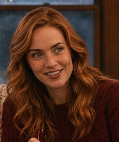 *stand-in* | Becca's face |

```
A 15-second cinematic live-action romantic comedy scene in 16:9. Late at night in a cozy bed-and-breakfast sitting room (Image 3): a soft sofa, a decorated Christmas tree, frosted windows, warm lamp and firelight. Open on the two-shot from Image 1. Kallista (Images 2 and 4) sits cross-legged on the left in an oversized charcoal knit sweater, holding a glass of red wine: pale skin, a longer face with defined cheekbones, large pale blue-grey eyes, sad slightly down-turned brows, straight sleek pale platinum-blonde hair with a center part. Reserved and deadpan; her feelings show only in her eyes. Becca (Images 2 and 5) sits on the right in a burgundy cable-knit sweater, holding a bottle of red wine by its neck: long wavy auburn hair, freckles, warm green-brown eyes. Warm, playful and teasing, with small, loose gestures. Keep both faces exactly as in the references.

Shot 1 (about 4s), the two-shot from Image 1: Kallista gives a small, embarrassed half-laugh, turns her wine glass and glances down. Kallista: "So... something weird happened today."
Cut to Shot 2 (about 2s), a medium close-up of Becca: she gasps, her eyes lighting up. Becca: "You met someone!"
Cut to Shot 3 (about 4s), a medium close-up of Kallista: she groans and tips her head back slightly, then looks at Becca, dry and defensive. Kallista: "No, Becca. I did not 'meet someone.'"
Cut to Shot 4 (about 4s), a medium close-up of Becca: a slow, teasing nod, not believing a word. Becca: "Mm-hm. The ice rink." She raises one eyebrow. Becca: "Hockey player."
Cut to Shot 5 (about 1s), back to the two-shot: Kallista gives her a flat, unimpressed look over the rim of her glass.

Voices: Kallista has a soft, low, dry American voice, a little husky and deadpan. Becca has a bright, warm American voice, quick and teasing. Only the woman speaking moves her lips.
Sound: a gentle crackling fireplace, soft room hum, the faint clink of a wine glass. No music, no other voices.
Look: 35mm Kodak Vision3 500T film with a 1/4 Pro-Mist filter, soft halation on the tree lights, shallow depth of field, organic film grain. No subtitles, no text, no watermark, no extra people.
```

---

## Scene 2: Rink flash, "Hey..." (5s)

| Image | File | Thumbnail | Role |
|---|---|---|---|
| 1 | Rink start frame (revision 2b, the close front-facing frame) |  | Opening composition |
| 2 | Your S4 rink set picture | — | The rink |
| 3 | Your Kallista identity shot 1 |  *stand-in* | Kallista's face |
| 4 | Your Kallista coat portrait (Outfit A + outdoor layer) | — | Coat and scarf |
| 5 | Your Chase portrait |  *stand-in* | Chase |

```
A 5-second cinematic live-action romantic comedy flashback in 16:9 at an outdoor small-town ice rink at dusk (Image 2): string lights, a lit gazebo, light snow. Open on Image 1: a medium close-up of Kallista (Images 3 and 4) on a wooden bench at the rink's edge, in a charcoal wool coat and dark grey chunky knit scarf: pale skin, a longer face, large pale blue-grey eyes, straight sleek pale platinum-blonde hair. Reserved and dry; she never speaks. Chase (Image 5) is a cocky young hockey player with tousled sandy-blond hair, deep dimples and a plain dark green jersey, with no helmet.

Shot 1 (about 1.2s), Image 1: Kallista looks down, lacing her skates. Behind her on the right, Chase skates fast straight toward her.
Shot 2 (about 0.8s), same framing: he skids to a hard hockey stop beside her, and a spray of shaved ice showers her coat, scarf and hair. She jerks back, both hands up, palms out, eyes wide.
Cut to Shot 3 (about 1.5s), a close two-shot: Chase leans in beside her with a dimpled grin. Chase: "Hey..."
Cut to Shot 4 (about 1.5s), a close-up of Kallista: she slowly lowers her hands, ice in her hair and eyebrows, and gives him a flat, completely unimpressed stare, mouth closed.

Voice: Chase has a smooth, cocky young American drawl.
Sound: skate blades carving the ice, the hard scrape of the stop, the hiss of spraying ice, distant skaters, a light breeze. No music.
Look: 35mm Kodak Vision3 500T film with a 1/4 Pro-Mist filter, warm string-light glow against a cool blue dusk, shallow depth of field, film grain. No subtitles, no text, no watermark.
```

---

## Scene 3: Couch, "The coffee shop!" / "Nobody does that." (12s)

In the Supergen cut, Becca's music-store line plays over Kallista's reaction. Omni Flash can lip-sync it on camera, so it's included here.

| Image | File | Thumbnail | Role |
|---|---|---|---|
| 1 | `keyframes/holiday-reservations/couch2_front_v2.png` |  | Opening composition and faces |
| 2 | Your S1 B&B sitting-room set picture | — | The room |
| 3 | Your Kallista identity shot 1 |  *stand-in* | Kallista's face |
| 4 | Your indoor Becca portrait |  *stand-in* | Becca's face |

```
A 12-second cinematic live-action romantic comedy scene in 16:9, continuing the late-night conversation on the sofa in the cozy bed-and-breakfast sitting room (Image 2). Open on Image 1, a frontal two-shot. Kallista (Images 1 and 3) is on the left in an oversized charcoal knit sweater with a glass of red wine: pale skin, a longer face, large pale blue-grey eyes, sad down-turned brows, straight sleek pale platinum-blonde hair with a center part; deadpan and contained. Becca (Images 1 and 4) is on the right in a burgundy cable-knit sweater, holding a bottle of red wine by its neck: long wavy auburn hair, freckles; warm and teasing. Keep both faces exactly as in the references, both mostly facing the camera.

Shot 1 (about 6s), the two-shot from Image 1, with a very slow push-in: Kallista gives Becca a slow, dead-eyed shake of her head. Becca points the bottle at her, leaning in, conspiratorial and delighted. Becca: "The coffee shop! He spelled your name wrong on purpose... so you'd have to talk to him."
Cut to Shot 2 (about 2s), a medium close-up of Kallista: she takes a small sip of wine, lowers the glass, flat. Kallista: "Nobody does that."
Cut to Shot 3 (about 3s), a medium close-up of Becca: her face lights up, and she sits up straight. Becca: "Ooh, the music store! Some broody musician."
Cut to Shot 4 (about 1s), a close-up of Kallista: she closes her eyes and sinks slightly into the sofa, mouth closed.

Voices: Kallista has a soft, low, dry American voice, a little husky and deadpan. Becca has a bright, warm American voice, quick and teasing.
Sound: a gentle crackling fireplace, soft room hum, a quiet sip and the clink of a glass. No music.
Look: 35mm Kodak Vision3 500T film with a 1/4 Pro-Mist filter, warm practical light, soft halation on the tree lights, shallow depth of field, film grain. No subtitles, no text, no watermark, no extra people.
```

---

## Scene 4: Café flash, "CALLISTUH" (4s)

| Image | File | Thumbnail | Role |
|---|---|---|---|
| 1 | `pic_550298c4b8ba` (barista start frame) | 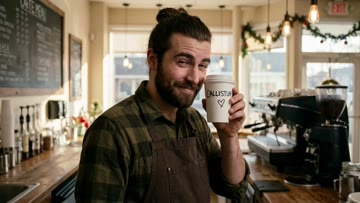 | Shot 1 composition and the cup |
| 2 | `pic_1e5dc4fea01a` (Kallista café stare) | 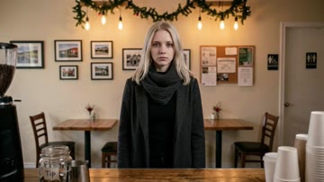 | Shot 2 composition |
| 3 | Your S5 café set picture | — | The café |
| 4 | Your Kallista identity shot 1 |  *stand-in* | Kallista's face |

```
A 4-second cinematic live-action romantic comedy flashback in 16:9 in a cozy small-town café in the morning (Image 3): a wooden counter, a chalkboard menu, an espresso machine, Christmas garland, warm window light.
Shot 1 (about 2s), matching Image 1, from the customer's point of view across the counter: a barista with a dark brown man bun, a groomed full beard, an olive flannel shirt and a brown canvas apron holds up a white paper cup beside his face. Written on it in black marker is "CALLISTUH" with a small heart, sharp and legible, and the writing never changes. He gives one slow, flirty wink and a smug little nod, mouth closed.
Cut to Shot 2 (about 2s), matching Image 2: Kallista (Images 2 and 4) stands at the counter facing the barista, in a charcoal wool coat over a black mock-neck and a dark grey chunky knit scarf: pale skin, a longer face, large pale blue-grey eyes, straight sleek pale platinum-blonde hair. A completely flat, dead stare. She blinks once, slowly. Her mouth stays closed.

Sound: café ambience, an espresso machine hissing, cups clinking softly, distant murmur. No dialogue, no music.
Look: 35mm Kodak Vision3 500T film with a 1/4 Pro-Mist filter, warm morning window light, shallow depth of field, film grain. No subtitles, no other text, no watermark.
```

---

## Scene 5: Music store, Adrian and the bossa nova (12s)

| Image | File | Thumbnail | Role |
|---|---|---|---|
| 1 | `keyframes/holiday-reservations/music_E_kallista_wide.png` | 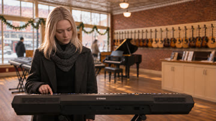 | Opening wide shot and the store |
| 2 | `keyframes/holiday-reservations/music_A_adrian_pov.png` |  | Adrian's reverse angle and face |
| 3 | `keyframes/holiday-reservations/music_C_kallista_stare.png` | 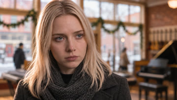 | Kallista's close-up |
| 4 | Adrian's full-body greatcoat shot |  | His coat, seen from behind as he enters |
| 5 | Your Kallista identity shot 1 |  *stand-in* | Kallista's face |
| 6 | The PSR-SX920 product photo (check it isn't mirrored) | — | The keyboard panel |
| 7 | *(optional)* Adrian's music-video headshot | 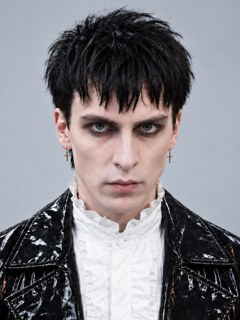 | Only if his face drifts. Its ruffled shirt can pull in the wrong wardrobe |

```
A 12-second cinematic live-action romantic comedy flashback in 16:9 in a small-town music store in the afternoon: brick walls, a wall of guitars, pianos, front windows with snow outside and garland. Five shots joined by clean hard cuts.
Kallista (Images 1, 3 and 5): pale skin, a longer face with defined cheekbones, large pale blue-grey eyes, sad down-turned brows, straight sleek pale platinum-blonde hair with a center part, a charcoal wool coat and a dark grey chunky knit scarf. Deadpan; she never speaks. Adrian (Images 2 and 4): pale skin, spiky black hair with a choppy fringe, smoky eyeliner, small gold cross earrings, a long black double-breasted greatcoat with silver buttons over a black turtleneck. A self-serious, brooding frontman, until things go wrong. They only ever look at each other; nobody looks into the camera.
The room: the keyboard (Image 6) stands in the middle of the store. Kallista stands behind it at its controls, with the front windows behind her. The camera starts on the other side, looking at the keyboard's back panel.

Shot 1 (about 2s), the wide shot from Image 1, locked: Kallista looks down and presses a button. Adrian walks in from the bottom-right corner on the camera's side of the keyboard with his back to us; we see only his spiky black hair and the back of his greatcoat. He stops across the keyboard from her and leans one elbow on it, facing her.
Cut to Shot 2 (about 2s), the reverse angle from Image 2, from Kallista's side: Adrian leans across the keyboard, elbow on the panel, chin on his hand, eyes on her just beside the camera. Adrian: "You play?"
Cut to Shot 3 (about 1s), Kallista's close-up from Image 3: her brow furrows slightly, mouth closed, while his voice continues off screen. Adrian: "Perhaps we could make..."
Cut to Shot 4 (about 4s), back on Adrian as in Image 2: he leans closer and murmurs. Adrian: "...something... beautifully dark—" Under the line, four quiet keyboard metronome ticks count in. On the word "dark" a cheesy 1990s home-keyboard bossa nova demo blasts on at full volume. He freezes, looks down in horror, then straightens and frantically twists knobs and prods panel buttons; the beat only speeds up. A cheesy keyboard voice sample shouts "Woo!"
Cut to Shot 5 (about 3s), closer on Kallista as in Image 3: she covers her mouth with her hand and lets out one short, stifled laugh, then stays deadpan behind her hand while the bossa nova keeps playing.

Voice: Adrian has a low, velvety British voice, self-serious and slow. Kallista's only sound is the short stifled laugh.
Sound: quiet store ambience; four soft metronome ticks; the tinny bossa nova demo (drum machine, cheap electric piano, plucky synth bass), getting faster; the "Woo!" sample; knob and button clicks. Background shoppers stay small and natural: people walk past outside the windows, and a clerk rings up a customer at the counter.
Look: 35mm Kodak Vision3 500T film with a 1/4 Pro-Mist filter, warm afternoon window light, shallow depth of field, film grain. No subtitles, no text, no watermark, no slow motion.
```
For a strictly like-for-like comparison, you can mute Omni Flash's audio and lay our post-production track on top (the bossa nova #1 mix).

---

## Scene 6: Couch, "You watch way too many of these movies." → "...The laundromat." (12s)
The risk here is **invented backgrounds on new angles** (the Omni Flash angled close-ups of Kallista and Becca drifted before). So every shot is told to match one of the attached camera setups exactly, and they're all frontal or three-quarter angles that already exist.

| Image | File | Thumbnail | Role |
|---|---|---|---|
| 1 | `keyframes/holiday-reservations/couch3_wide_three.png` |  | Opening wide; the stare |
| 2 | `keyframes/holiday-reservations/couch2_front_v2.png` |  | Frontal two-shot of Kallista and Becca |
| 3 | `keyframes/holiday-reservations/milly_mcu_crop.png` | 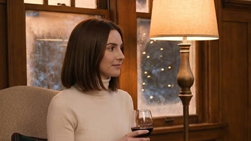 | Milly's close-up |
| 4 | `keyframes/holiday-reservations/kallista_mcu_crop.png` | 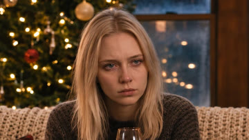 | Kallista's close-up |
| 5 | Your Kallista identity shot 1 |  *stand-in* | Kallista's face |
| 6 | Your indoor Becca portrait |  *stand-in* | Becca's face |
| 7 | Your Milly portrait | — | Milly's face |

```
A 12-second cinematic live-action romantic comedy scene in 16:9, late at night in a cozy bed-and-breakfast sitting room: a Christmas tree, frosted windows, wood paneling, warm lamplight. Five shots joined by clean hard cuts. Use ONLY the camera setups shown in Images 1–4, each with exactly the background shown in its image: Image 1 is the wide shot of the room, Image 2 the frontal two-shot of the sofa, Image 3 Milly's close-up, Image 4 Kallista's close-up. No other angles, no profile shots, no over-the-shoulder shots.

Kallista (Images 2, 4 and 5) sits on the left end of the sofa in an oversized charcoal knit sweater with a glass of red wine: pale skin, a longer face with defined cheekbones, large pale blue-grey eyes, sad down-turned brows, straight sleek pale platinum-blonde hair with a center part. Dry and deadpan. Becca (Images 2 and 6) sits on the right end of the sofa in a burgundy cable-knit sweater, holding a bottle of red wine: long wavy auburn hair, freckles. Warm and teasing. Milly (Images 1, 3 and 7) sits perfectly upright in the armchair to the left of the sofa in a pressed cream turtleneck, holding an untouched glass of wine: a sleek glossy chestnut-brown bob, flawless symmetrical features. Pleasant, polite, rarely blinks, a beat late. Keep all three faces exactly as in the references. Nobody looks into the camera.

Shot 1 (about 3s), the two-shot from Image 2: Kallista scoffs and lowers her glass. Kallista: "You watch way too many of these movies."
Cut to Shot 2 (about 3s), Milly's close-up from Image 3: after a beat, perfectly still, looking toward the sofa. Milly: "Statistically, most people meet at work."
Cut to Shot 3 (about 2s), the wide shot from Image 1: complete silence. Kallista and Becca slowly turn their heads to the left and stare at Milly. Milly holds a polite, unblinking smile.
Cut to Shot 4 (about 2s), the two-shot from Image 2: Becca snaps back to Kallista, eager and exasperated. Becca: "Then where?!"
Cut to Shot 5 (about 2s), Kallista's close-up from Image 4: she sinks slightly into the sofa, reluctant and quiet. Kallista: "...The laundromat."

Voices: Kallista has a soft, low, dry American voice, a little husky and deadpan. Becca has a bright, warm American voice, quick and teasing. Milly has a flat, even, pleasant American voice that answers a beat late. Each line is spoken once, in this order; only the woman speaking moves her lips.
Sound: a gentle crackling fireplace and soft room hum; silence during the stare. No music.
Look: 35mm Kodak Vision3 500T film with a 1/4 Pro-Mist filter, warm practical light, soft halation on the tree lights, shallow depth of field, film grain. No subtitles, no text, no watermark, no extra people.
```

### Scene 6b: the bra line (5s). Image 1 = `kallista_mcu_crop.png`, Image 2 = your Kallista identity shot
```
A 5-second cinematic live-action close-up in 16:9, matching Image 1 exactly, with her face as in Image 2 (Kallista on the sofa, the Christmas tree and frosted window behind her). Locked camera, no cuts. Kallista: pale platinum-blonde hair, a longer face, pale blue-grey eyes, an oversized charcoal sweater, a glass of red wine; dry and deadpan; she looks to the right of the camera at her friend, never into the lens. Her friend's delighted voice comes from off screen. Becca (off screen, bright and gushing): "That's adorable!" Kallista gives a small, pained look, then says flatly: "My bra was stuck to his back." She takes a slow sip of wine. Voices: Kallista soft, low and dry; Becca bright and warm. Sound: crackling fireplace, soft room hum. No music, no subtitles, no watermark.
```

---

## Scene 7: The laundromat, the real meet-cute (setup + two dialogue shots)
**The logic:** Kallista is on her second load. Her bra stayed stuck inside the dryer from her first load, Cal used that dryer next, and it came out clinging to his flannel. **Kallista is in the room from the first shot** (head down, unloading), so she doesn't pop in from nowhere.
**Prop:** the original black lace bra (the developer dropped the Supergen guardrail; Omni Flash accepted it).

| Thumb | File | Role |
|---|---|---|
| 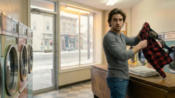 | `keyframes/holiday-reservations/laundromat_LM0_setup.png` | Cal with the flannel |
| 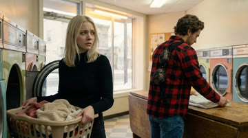 | `keyframes/holiday-reservations/laundromat_LM1_reveal.png` | The reveal: 7.0 last frame / 7a opening |
| 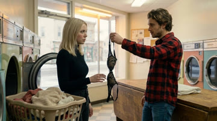 | `keyframes/holiday-reservations/laundromat_LM2_holdup.png` | 7b opening |
| 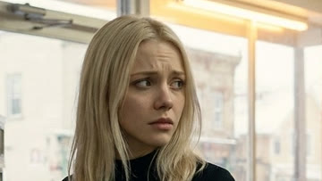 | `keyframes/holiday-reservations/laundromat_LM1_kallista_cu.png` | Kallista's close-up (crop of LM1, her exact face) |
| 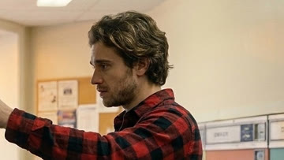 | `keyframes/holiday-reservations/laundromat_LM3_cal_cu.png` | Cal's close-up (crop of LM2) |
Plus your Kallista identity shot 1, and your Cal front close-up and full-body shots, from the Cast folder.

### 7.0: Setup, fresh out of the dryer (4s, silent): first + last frame mode
First frame: the both-in-frame setup (Kallista head down at her dryer, Cal holding the flannel); or LM0 if you don't have it yet. Last frame: LM1. Ingredients (if offered): your Cal front close-up and the Kallista identity shot.
**Fix for warping:** he turns his back to the camera and swings the shirt over his head like a cape, so it never passes in front of his chest.
```
A 4-second cinematic live-action romantic comedy shot in 16:9 in a small-town laundromat, moving from the first frame to the last frame in one continuous shot, locked camera, no zoom.
0–1 second: the man holds his red-and-black flannel up by the collar, the black lace bra stuck to the outside of the shirt. He gives a polite glance toward the blonde woman at the dryers on the left; her head is tilted down, absorbed in pulling laundry out of her dryer into her basket, and she doesn't notice him.
1–2.5 seconds: he turns his back to the camera toward the folding counter and, in one smooth motion, swings the shirt up and over his head and down behind his shoulders like a cape, then slips his right arm, then his left, into the sleeves. The shirt never passes in front of his chest; the bra stays stuck to the back of the shirt, between his shoulder blades, facing the camera.
2.5–4 seconds: he leans over the counter and starts folding a towel, matching the last frame. The woman lifts her head, glances toward his back, and her expression turns uneasy, matching the last frame.
No cuts, no morphing, no warping of the shirt. Sound: dryers tumbling, a soft machine hum. No dialogue, no music, no subtitles, no watermark.
```

### 7a: "Oh my god." → "...borrowing something of yours." (15s)
Images: 1 = LM1, 2 = LM2, 3 = Kallista close-up (LM1 crop), 4 = Cal close-up (LM3), 5 = Kallista identity, 6 = Cal front close-up, 7 = Cal full body.
```
A 15-second cinematic live-action romantic comedy scene in 16:9 in a small-town laundromat on a snowy winter day: retro dryers along the left wall, a wooden folding counter on the right, front windows with snow outside. Open on the composition of Image 1 and hold it, locked camera, no zoom. Use only the room and camera setups shown in Images 1–4, keeping exactly the same backgrounds; clean hard cuts only, no new angles.
Kallista (Images 1, 3 and 5), at the dryer on the left with her laundry basket: pale skin, a longer face, large pale blue-grey eyes, sad down-turned brows, straight sleek pale platinum-blonde hair, a black ribbed mock-neck; reserved and mortified. Cal (Images 1, 4, 6 and 7), at the counter on the right with his back half turned: tousled brown hair, light stubble, a red-and-black buffalo-check flannel with a black lace bra stuck to the back; sweet, earnest, a little flirty, oblivious. Nobody looks into the camera.

Shot 1 (about 3s), Image 1: Kallista glances at his back, looks away, then does a double-take, her eyes going wide. Kallista, whispering to herself: "Oh my god."
Cut to Shot 2 (about 4s), Kallista's close-up from Image 3: she gathers herself. Kallista: "Um... excuse me. You have... something of mine."
Cut to Shot 3 (about 5s), Cal's close-up from Image 4: he turns to her, confused and friendly. Cal: "Something of yours?" A slow, charming smile, a little flirty, as he starts patting his pockets. Cal: "I think I'd remember borrowing something of yours."
Cut to Shot 4 (about 3s), Image 1: still facing her, he glances over his left shoulder, then his right, then reaches back over his shoulder, feels something and slowly peels it off his back, freezing as he sees what it is. Kallista watches, mouth closed, mortified.

Voices: Kallista has a soft, low, dry American voice, a little husky. Cal has a warm, boyish American voice, gentle and mid-low with a slight rasp. Only the person speaking moves their lips.
Sound: dryers tumbling, a soft machine hum, quiet winter street outside. No music.
Look: 35mm Kodak Vision3 500T film with a 1/4 Pro-Mist filter, warm winter daylight, shallow depth of field, film grain. No subtitles, no text, no watermark, no extra people.
```

### 7b: The freeze → "Not with one this nice." (15s)
Images: 1 = LM2, 2 = LM1, 3 = Kallista close-up (LM1 crop), 4 = Cal close-up (LM3), 5 = Kallista identity, 6 = Cal front close-up, 7 = Cal full body.
```
A 15-second cinematic live-action romantic comedy scene in 16:9 in the same small-town laundromat. Open on the composition of Image 1: Kallista (left) and Cal (right) face each other; he holds a black lace bra up by one strap between them. Use only the camera setups shown in Images 1, 3 and 4, keeping exactly the same backgrounds; clean hard cuts only, no new angles.
Kallista (Images 1, 3 and 5): pale platinum-blonde hair, a longer face, pale blue-grey eyes, sad down-turned brows, a black mock-neck, cheeks slightly flushed; deadpan. Cal (Images 1, 4, 6 and 7): tousled brown hair, light stubble, a buffalo-check flannel; trying very hard to be a gentleman. Nobody looks into the camera.

Shot 1 (about 2s), the two-shot from Image 1: silence. Both freeze, staring at the bra between them.
Cut to Shot 2 (about 6s), Cal's close-up from Image 4: an embarrassed laugh. Cal: "Guess we used the same dryer." Then, sheepish and earnest. Cal: "I'd like to say this has never happened to me before."
Cut to Shot 3 (about 1s), Kallista's close-up from Image 3: she snatches the bra back. Kallista, dry and suspicious: "Has it?"
Cut to Shot 4 (about 2s), Cal's close-up from Image 4: a shy grin. Cal: "Not with one this nice."
Shot 5 (about 4s), the two-shot from Image 1: Kallista almost smiles, catches herself, picks up her laundry basket and walks out past the camera; Cal watches her go.

Voices: Kallista has a soft, low, dry American voice, a little husky. Cal has a warm, boyish American voice, gentle and mid-low with a slight rasp. Only the person speaking moves their lips.
Sound: dryers tumbling, a soft machine hum, quiet winter street outside. No music.
Look: 35mm Kodak Vision3 500T film with a 1/4 Pro-Mist filter, warm winter daylight, shallow depth of field, film grain. No subtitles, no text, no watermark, no extra people.
```
For a like-for-like comparison with Supergen, mute Omni Flash's audio and lay in `laundromat_L1_v5_15s.mp3` / `laundromat_L2_v4_15s.mp3` (these match the Supergen takes).

---

# PART 2: MONTAGE

Same rules as above. Character faces: attach your identity headshots (Kallista, Cal, Becca, Milly, Marcus). M4 (cocoa break) and M6 (icy sidewalk) are added once their keyframes exist.

## Scene M1: Porch, "Are you following me?" (10s)

| Image | File | Thumbnail | Role |
|---|---|---|---|
| 1 | `keyframes/holiday-reservations/m1_porch_P1.png` (or the new step-repair keyframe from the keeper render) | 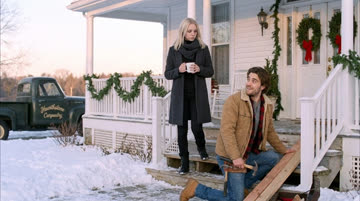 | Opening composition |
| 2 | Kallista identity headshot |  *stand-in* | Kallista's face |
| 3 | Cal identity headshot | — | Cal's face |

```
A 10-second cinematic live-action romantic comedy scene in 16:9 on the front porch of a white Victorian bed-and-breakfast on a snowy winter morning, wreaths on the doors, garland on the porch rail, a green "Hearthstone Carpentry" pickup truck parked by the house. Open on Image 1.

Kallista (Image 2) stands on the porch steps holding a white coffee mug: pale skin, a longer face with defined cheekbones, large pale blue-grey eyes, sad down-turned brows, straight sleek pale platinum-blonde hair with a center part, a long charcoal wool coat, a black turtleneck and a dark grey chunky knit scarf. Dry, deadpan, suspicious; a soft, low, dry American voice, a little husky. Cal (Image 3) kneels in front of the steps, nailing a new pine tread board flat into the gap where a step is missing, a hammer in his hand: tousled brown hair, light stubble, warm hazel eyes, a tan canvas work jacket with a sherpa collar over a red-and-black flannel, a leather tool belt. Sweet, a little sheepish, quick to grin; a warm, boyish American voice with a slight rasp.

Kallista stops on the steps and stares down at Cal, who is busy nailing the new tread into the step. Kallista says, dry and suspicious: "Are you following me?" Cal stops mid-swing, freezes, and slowly looks up at Kallista. After a beat, Cal holds up the hammer as evidence and says, sheepish with a small grin: "I was hired... in August." Kallista narrows her eyes and takes a slow sip of coffee; Cal goes back to nailing the new tread into the step, still grinning.

Only the character named for each line speaks it. Nobody looks into the camera. Keep both faces and the porch consistent in every shot. Sound: a hammer tapping wood, a soft winter breeze, distant birds. No music, no subtitles, no text, no watermark, no extra people.
```

## Scene M2: Side yard, "Dark dream-pop" (10s)

| Image | File | Thumbnail | Role |
|---|---|---|---|
| 1 | `keyframes/holiday-reservations/m2_sideyard_Y1.png` | 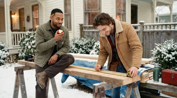 | Opening composition |
| 2 | Marcus identity headshot | — | Marcus's face |
| 3 | Cal identity headshot | — | Cal's face |

```
A 10-second cinematic live-action romantic comedy scene in 16:9 in the snowy side yard of a white Victorian bed-and-breakfast, set up as a carpentry work area: sawhorses with a pine board, lumber under a blue tarp, a thermos and a red toolbox. Open on Image 1.

Marcus (Image 2) sits on the end of the sawhorse plank eating a red apple: a handsome light-skinned Black man around thirty, short tapered dark hair, a neatly trimmed beard, warm brown eyes, an olive-green canvas work jacket over a navy henley, a carpenter's pencil behind his ear. Relaxed, quick-witted and dry, always smirking; a smooth, warm, mid-to-low American voice. Cal (Image 3) stands at the other end measuring and marking the board with a yellow tape measure and a pencil: tousled brown hair, light stubble, a tan canvas work jacket with a sherpa collar over a red-and-black flannel. Focused and quietly confident, eyes on his work; a warm, boyish American voice with a slight rasp.

Marcus takes a crunchy bite of the apple and, chewing, Marcus says, amused and dry: "Dark dream-pop. That's just pop... that didn't get enough sleep." Without looking up, Cal says with a knowing half-smile: "You looked her up." Marcus freezes mid-chew, caught, then shrugs it off with swagger, points the apple at Cal and Marcus says mid-chew: "She's got style." Cal keeps measuring, hiding a smile.

Only the character named for each line speaks it. Nobody looks into the camera. Keep both faces and the yard consistent in every shot. Sound: a pencil scratching wood, a tape measure snapping back, a soft winter breeze. No music, no subtitles, no text, no watermark, no extra people.
```

## Scene M3: Sitting room, "You're watching him again." (10s)

| Image | File | Thumbnail | Role |
|---|---|---|---|
| 1 | `keyframes/holiday-reservations/m3_sittingroom_S1.png` | 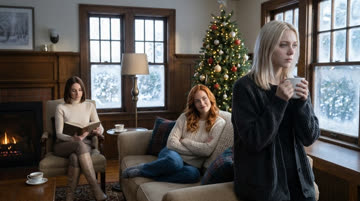 | Opening composition |
| 2 | Kallista identity headshot |  *stand-in* | Kallista's face |
| 3 | Becca indoor portrait |  *stand-in* | Becca's face |
| 4 | Milly portrait |  *stand-in* | Milly's face |

```
A 10-second cinematic live-action romantic comedy scene in 16:9 in a cozy bed-and-breakfast sitting room on a clear winter morning: frosted windows, a decorated Christmas tree, a low fire. Open on Image 1.

Kallista (Image 2) stands at the frosted window holding a white mug at her chin, gazing outside: pale skin, a longer face with defined cheekbones, large pale blue-grey eyes, sad down-turned brows, straight sleek pale platinum-blonde hair with a center part, a dark charcoal cardigan. Dry and deadpan; a soft, low, dry American voice, a little husky. Becca (Image 3) reclines on the sofa with her arms crossed: long wavy auburn hair, freckles, a cream cable-knit sweater. Warm and teasing; a bright, warm American voice. Milly (Image 4) sits perfectly upright in the armchair by the fireplace, reading a hardcover book: a sleek glossy chestnut-brown bob, flawless symmetrical features, a pressed cream turtleneck. Superior and unbothered; a calm, even, slightly snarky American voice.

Becca says, teasing: "You're watching him again." Without turning from the window, Kallista says flatly: "I'm drinking coffee." Becca says, dry: "Your mug is empty." Kallista glances down into her empty mug and slowly lowers it. Without looking up from her book, Milly turns a page, takes a casual sip of tea, and Milly says: "Textbook denial. Honestly, it's embarrassing." Becca bites back a grin; Kallista turns back to the window.

Only the character named for each line speaks it. Milly never looks up from her book. Nobody looks into the camera. Keep all three faces and the room consistent in every shot. Sound: a crackling fire, a page turning, a teacup clinking on its saucer, soft room hum. No music, no subtitles, no text, no watermark, no extra people.
```
(The original said "bright winter morning"; "bright" is on the watch-word list, so it is "clear" here.)

## Scene M5: Town-square piano, "Some things are supposed to sound... a little broken." (10s)

| Image | File | Thumbnail | Role |
|---|---|---|---|
| 1 | `keyframes/holiday-reservations/m5_piano_A_master.jpg` | 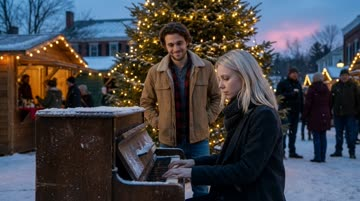 | Opening composition |
| 2 | `keyframes/holiday-reservations/m5_piano_B_bench.jpg` | 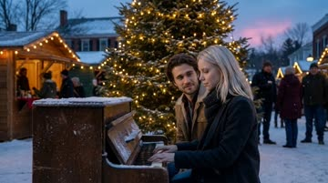 | Final position (on the bench) |
| 3 | Kallista identity headshot |  *stand-in* | Kallista's face |
| 4 | Cal identity headshot | — | Cal's face |

```
A 10-second cinematic live-action romantic comedy scene in 16:9 at dusk at a small-town winter holiday fair: an old weathered upright piano with snow on its lid beside a tall Christmas tree strung with warm lights, wooden market stalls glowing behind. Open on Image 1.

Kallista (Image 3) sits at the piano playing quietly, eyes on the keys: pale skin, a longer face with defined cheekbones, large pale blue-grey eyes, straight sleek pale platinum-blonde hair with a center part, a charcoal wool coat and a dark grey chunky knit scarf. Reserved and absorbed; a soft, low, dry American voice, a little husky. Cal (Image 4) stands just behind her, hands in his pockets: tousled brown hair, light stubble, warm hazel eyes, a tan sherpa-collar work jacket over a red-and-black flannel. Warm and gently teasing; a warm, boyish American voice with a slight rasp.

Shot 1 (about 3s), the two-shot from Image 1: Kallista plays a few soft, slightly out-of-tune notes. Cal leans in a little and Cal says, gently teasing: "I could fix that."
Cut to Shot 2 (about 4s), a closer three-quarter shot of Kallista at the keys, Cal soft behind her shoulder. She keeps playing and does not look up, and Kallista says softly, almost to herself: "Some things are supposed to sound... a little broken."
Cut to Shot 3 (about 3s), matching Image 2: Cal sits beside her on the piano bench, shoulder to shoulder, looking at her with a soft, sincere expression, saying nothing. She keeps playing, a small private almost-smile on her lips.

Only the character named for each line speaks it. The two of them only ever look at each other or at the piano; nobody looks into the camera. Keep both faces consistent in every shot. Fair-goers in winter coats stroll between the stalls, chatting and sipping from paper cups; snow falls gently throughout. Sound: a few soft, slightly out-of-tune piano notes, the murmur of the fair in the distance. No music beyond her playing, no subtitles, no text, no watermark.
```

## Scene M7: Half-open door (5s, silent)

| Image | File | Thumbnail | Role |
|---|---|---|---|
| 1 | `keyframes/holiday-reservations/m7_door_D1.jpg` | 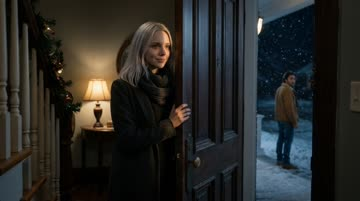 | Opening composition |
| 2 | Kallista identity headshot |  *stand-in* | Kallista's face |
| 3 | Cal identity headshot | — | Cal's face |

```
A 5-second cinematic live-action romantic drama shot in 16:9, one continuous shot with a locked camera. Night, inside the dim front hallway of a Victorian bed-and-breakfast: a staircase with garland, a lamp glowing on a side table. Open on Image 1.

Kallista (Image 2) stands at the half-open front door with her hand on its edge, watching Cal through the gap: pale skin, a longer face with defined cheekbones, large pale blue-grey eyes, straight sleek pale platinum-blonde hair with a center part, a charcoal wool coat and a dark grey chunky knit scarf. Her head and body stay where they are for the whole shot; her face stays turned toward the camera in three-quarter view, and only her eyes move, following Cal. Outside in the softly falling snow, Cal (Image 3), in a tan work jacket, holds her gaze, gives a small shy nod, then turns and walks slowly away down the snowy path, glancing back once over his shoulder. Kallista's fingers tighten on the door's edge as if to close it, but she hesitates and the door stays half open. Her small closed-lip almost-smile slowly deepens, just slightly. Subtle, restrained performance.

Nobody speaks. Nobody looks into the camera. Keep both faces as in the references. Sound: a quiet winter night, soft wind, a distant wind chime. No music, no subtitles, no text, no watermark.
```

---

# PART 3: CAST ROLL AND STINGER

Each cast shot is its own 5s clip (use 2–4s in the edit; name cards are added afterwards). Attach the cast frame first, then the character's headshot.

## Cast 1: KALLISTA VANE (5s)
| Image | File | Thumbnail |
|---|---|---|
| 1 | `keyframes/holiday-reservations/castroll/cast_kallista.png` |  |
| 2 | Kallista identity headshot |  *stand-in* |
```
A 5-second cinematic live-action medium close-up in 16:9, one continuous shot, locked camera. Open on Image 1: Kallista (Image 2) in a quiet snowy field at golden hour, pine trees soft behind her, light snow glowing in the warm backlight: pale skin, a longer face, large pale blue-grey eyes, straight sleek pale platinum-blonde hair with a center part, a charcoal coat and a dark grey knit scarf. She slowly turns her head toward the camera and the faintest half-smile appears, one she is trying to hide. This is a trailer cast-roll shot, so she may look into the lens. She says nothing. Sound: soft winter wind. No music, no subtitles, no text, no watermark.
```

## Cast 2: CAL WHITAKER (two 5s clips: the swing, then the grin)
| Image | File | Thumbnail |
|---|---|---|
| 1 (swing) | `castroll/cast_cal_A_swing.png` | 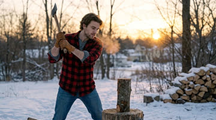 |
| 1 (grin) | `castroll/cast_cal_B_grin.png` | 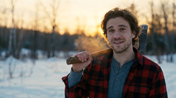 |
| 2 | Cal identity headshot | — |
```
SWING: A 5-second cinematic live-action medium shot in 16:9, locked camera. Open on Image 1: Cal (Image 2) at a chopping block in a snowy clearing at golden hour, a red-and-black buffalo-check flannel with the sleeves rolled up over a grey thermal henley, work gloves. He brings the axe down in one clean swing; the log splits and the two halves fall away, wood chips flying. Sound: a soft, muffled axe thunk and a wood crack. No music, no subtitles, no text, no watermark.

GRIN: A 5-second cinematic live-action medium close-up in 16:9, locked camera. Open on Image 1: Cal (Image 2), axe resting on his shoulder, breath fogging in the cold, tousled brown hair, light stubble, warm hazel eyes. He catches his breath, breaks into a warm, boyish grin, ducks his head bashfully, then looks back up toward the camera. He says nothing. Sound: soft winter wind. No music, no subtitles, no text, no watermark.
```

## Cast 3: BECCA HARTLEY (5s)
| Image | File | Thumbnail |
|---|---|---|
| 1 | `castroll/cast_becca.png` | 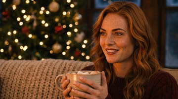 |
| 2 | Becca indoor portrait |  *stand-in* |
```
A 5-second cinematic live-action medium close-up in 16:9, locked camera. Open on Image 1: Becca (Image 2) curled up on the cozy bed-and-breakfast sofa at night by the Christmas tree, a big mug of hot cocoa in both hands: long wavy auburn hair, light freckles, warm green-brown eyes, a burgundy cable-knit sweater, warm firelight. Gazing dreamily off to the side, she raises the mug, takes a slow sip, lowers it with a contented, lovestruck sigh and starts to lean back into the cushions. The marshmallows stay in the mug. She says nothing. Sound: a crackling fire, a soft sigh. No music, no subtitles, no text, no watermark.
```

## Cast 4: MARCUS BELL (5s)
| Image | File | Thumbnail |
|---|---|---|
| 1 | `castroll/cast_marcus_v2.png` (logo-free) |  |
| 2 | Marcus identity headshot | — |
```
A 5-second cinematic live-action medium close-up in 16:9, locked camera. Open on Image 1: Marcus (Image 2) sits on a sawhorse in the snowy side yard at golden hour, small white wireless earbuds in, a phone in one hand: a handsome light-skinned Black man around thirty, short tapered dark hair, a neatly trimmed beard, an olive-green canvas work jacket. Eyes closed, he earnestly vibes to the music with small nods; then his eyes open, he realizes he is being watched, freezes with a little "oh", and slowly breaks into a sly grin toward the camera. He says nothing. Sound: soft winter wind, faint tinny music leaking from the earbuds. No other music, no subtitles, no text, no logos, no watermark.
```

## Cast 5: "and introducing" MILLY ALWOOD (two 5s clips: wide, then close-up)
| Image | File | Thumbnail |
|---|---|---|
| 1 (wide) | `castroll/cast_milly_A_wide.png` | 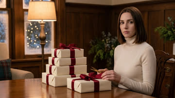 |
| 1 (close-up) | `castroll/cast_milly_B_closeup.png` | 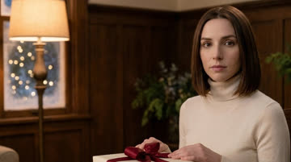 |
| 2 | Milly portrait |  *stand-in* |
```
WIDE: A 5-second cinematic live-action shot in 16:9, locked camera. Open on Image 1: Milly (Image 2) at the bed-and-breakfast dining table, finishing a gift with a flawless bow beside a stack of identically wrapped boxes in perfect alignment: a sleek glossy chestnut-brown bob, flawless symmetrical features, a pressed cream turtleneck. With small scissors she trims both ribbon tails to exactly the same length: snip, snip. Sound: two crisp scissor snips, soft room tone. No music, no subtitles, no text, no watermark.

CLOSE-UP: A 5-second cinematic live-action close-up in 16:9, locked camera. Open on Image 1: Milly (Image 2) looks up from the gift and stares into the lens, completely still and unblinking; a perfectly symmetrical smile arrives a beat too late and holds a little too long. She says nothing. Sound: soft room tone. No music, no subtitles, no text, no watermark.
```

## Stinger: Adrian, "...Beautifully dark." (5s)
| Image | File | Thumbnail |
|---|---|---|
| 1 | `keyframes/holiday-reservations/stinger_closing.png` | 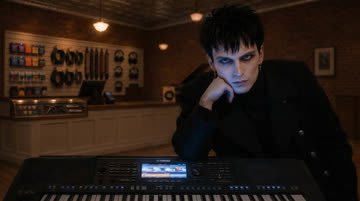 |
| 2 | Adrian headshot |  |
```
A 5-second cinematic live-action comedy shot in 16:9, one continuous shot, locked camera. Night in a closed, dark music store, lit only by the glow of a keyboard screen, a desk lamp and street lamps through the windows. Open on Image 1: Adrian (Image 2) sits alone behind the keyboard, chin on his hand, defeated. The keyboard is still playing a cheerful, tinny bossa nova demo loop; it cuts off and the keyboard chirps a cheesy synthesized "WOO!". Adrian stays frozen in a deadpan stare straight into the lens, lets out one long exhale, and then Adrian says quietly, to himself, in a low, velvety British voice: "...Beautifully dark." He does not move after the line. Sound: the tinny bossa loop, the "WOO!", then near silence and the store's soft hum. No subtitles, no text, no watermark.
```
